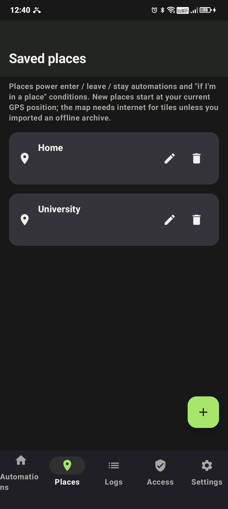
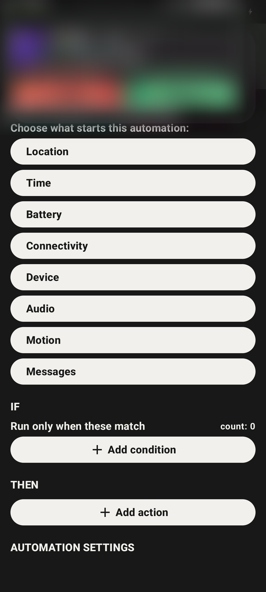
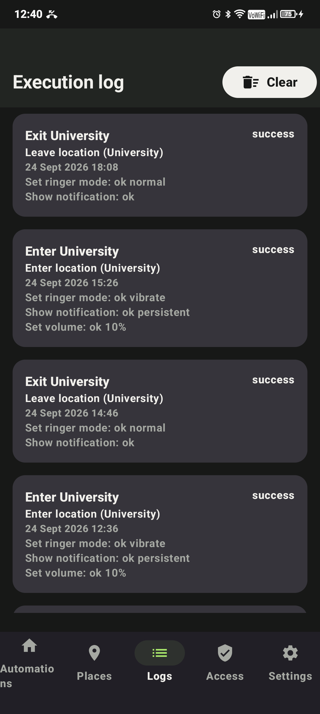
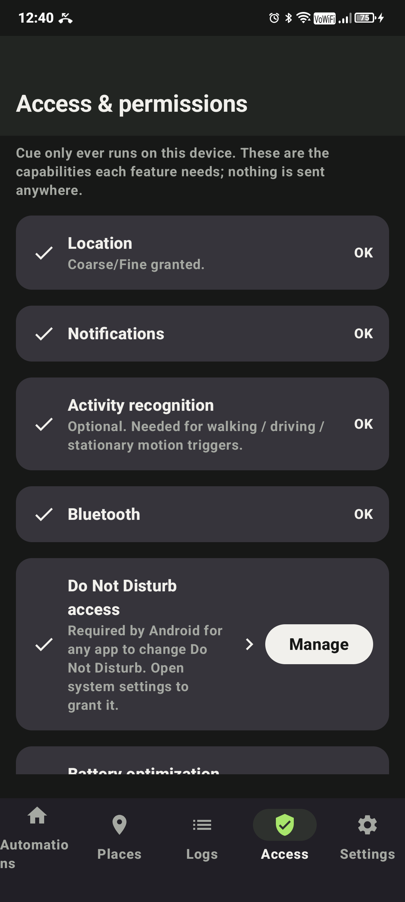
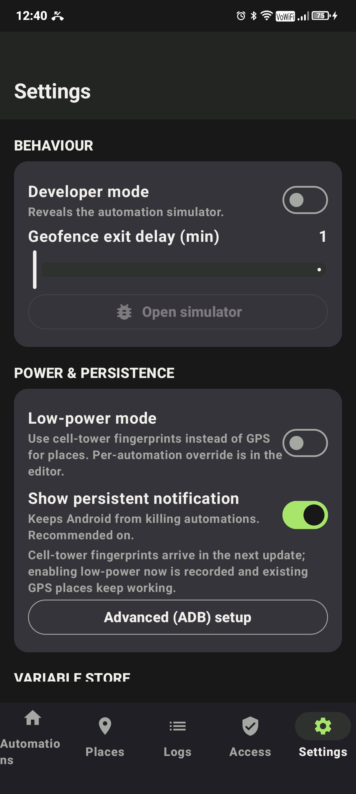

<picture>
  <source media="(prefers-color-scheme: dark)" srcset="assets/brand/cue-wordmark-dark-background.svg">
  
</picture>

# Cue — local-first Android automation

**When something happens, if conditions match, then do something.** Cue is a Tasker-style rules engine for modern Android (API 26–36): geofence, time, battery, connectivity, motion, notification and system triggers driving device actions — all evaluated on-device. No cloud, no account, no tracking.

## Screenshots

| Places | Automation editor | Execution log | Access & permissions | Settings |
|---|---|---|---|---|
|  |  |  |  |  |

## Features

**Triggers** — GPS geofences (enter / leave / dwell), low-power cell-tower areas with learned fingerprints, time-of-day, battery level / charging, Wi-Fi & Bluetooth connect/disconnect, screen on/off/unlock, Do Not Disturb, headset plug, activity recognition (still / walking / driving…), significant motion, device pickup, foreground-app change, volume keys, notifications, SMS, call state, calendar events, USB attach/detach, logcat patterns, device boot.

**Conditions** — time windows, days of week, battery, charging, Wi-Fi state/network, Bluetooth state/device, DND, screen, activity, location.

**Actions** — notifications, DND, volume, ringer mode, vibration, brightness, flashlight, TTS speech, Wi-Fi/Bluetooth/mobile-data (via settings where Android blocks direct toggles), app launch, links, system settings pages, variables, plus ADB-unlocked secure settings (airplane mode, GPS mode, battery saver, always-on display, night light, private DNS, immersive mode, animation speed), accessibility actions (lock screen, taps, swipes, screenshot) and notification dismissal.

**Execution policies** — once per change, every match, or cooldown, with an honest execution log for every run (success / partial / failed / condition-fail / cooldown-skipped).

## Power modes

- **GPS mode** — Play Services geofencing, meter-level radii.
- **Low-power mode** — cell-tower fingerprints instead of GPS: open a place, hit *Record cells*, walk the area for 10s–5min. Zero GPS drain. Per-automation GPS override available.

## Permissions & one-time setup

Most capabilities use normal runtime permissions (location, notifications, alarms). Three tiers need manual grants in the **Access** tab:

1. **System settings pages** — exact alarms, battery-optimization exemption, background location (“Allow all the time”), DND access.
2. **In-app toggles** — notification access, accessibility service.
3. **One-time ADB grants** (from a laptop, guided by the in-app *Advanced (ADB) setup* wizard):
   ```bash
   adb shell pm grant dev.context.app android.permission.WRITE_SECURE_SETTINGS
   adb shell pm grant dev.context.app android.permission.READ_LOGS
   adb shell pm grant dev.context.app android.permission.DUMP
   adb shell pm grant dev.context.app android.permission.PACKAGE_USAGE_STATS
   ```

## Build

```bash
# JDK 17 required
export JAVA_HOME="/path/to/jdk-17"
./gradlew :app:assembleDebug :app:testDebugUnitTest
adb install -r app/build/outputs/apk/debug/app-debug.apk
```

Requires Android SDK 36, min SDK 26.

## Architecture

```
TriggerProvider → ProviderSink → AutomationEngine → ActionExecutor
     (broadcasts, sensors,      (transitions,       (public APIs,
      geofences, alarms,          dedup, cooldown)    secure settings,
      telephony, observers)                         accessibility, intents)
```

Providers normalize platform callbacks into `TriggerEvent`s; the engine evaluates conditions against a `RuntimeSnapshot` and records an `ExecutionLog`. State lives in Room; preferences in DataStore. Zero polling — everything is event-driven.

## Attribution

- Map tiles © [OpenStreetMap](https://www.openstreetmap.org/copyright) contributors (ODbL), rendered with [osmdroid](https://github.com/osmdroid/osmdroid) (Apache-2.0).
- Brand assets in `assets/brand/` by the Cue team.
